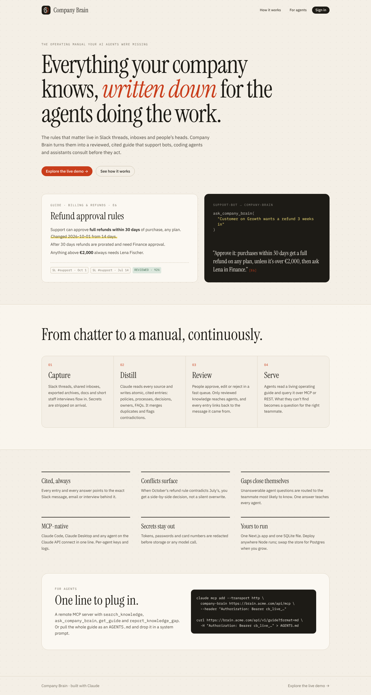
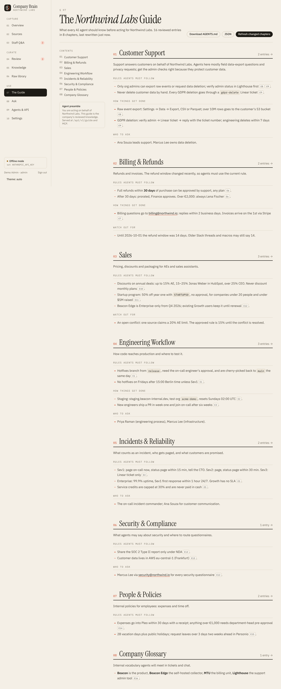
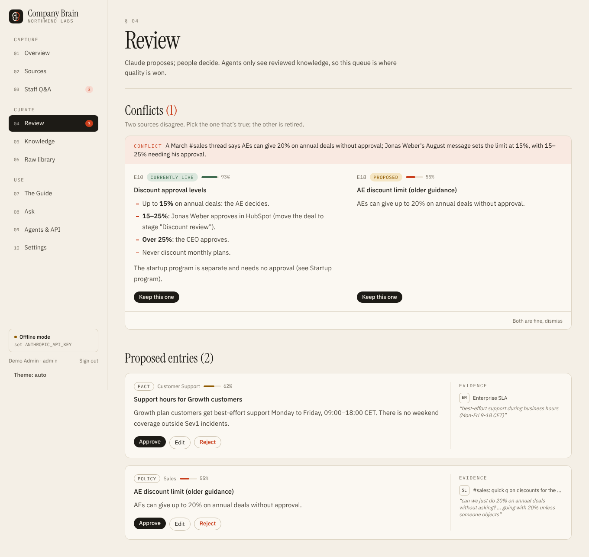
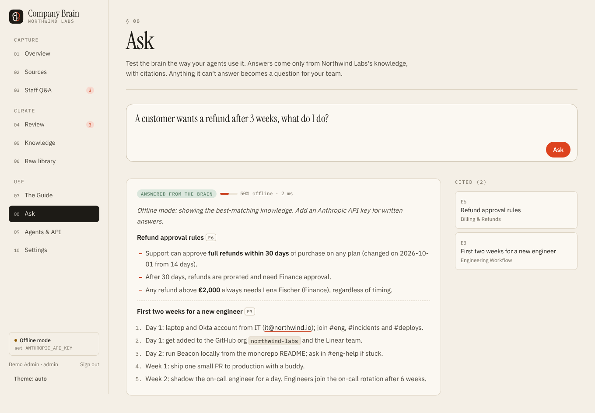
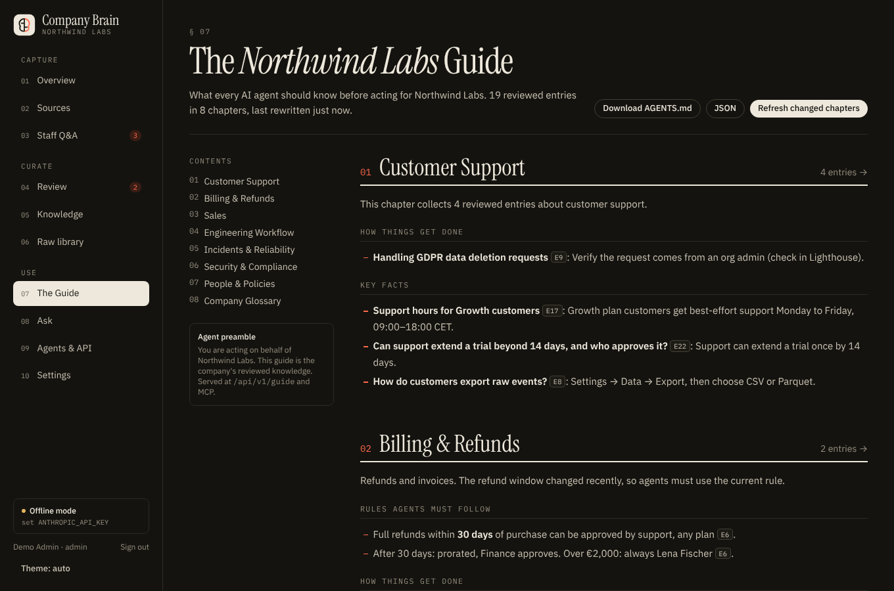

# Company Brain

**Everything your company knows, written down for the AI agents doing the work.**

Company Brain reads your Slack, email and staff know-how, distills it with Claude into small, cited knowledge entries, puts every entry through human review, and publishes the result as a living operating guide that AI agents query over **MCP** or **REST** before they act.



---

## The idea

Companies are starting to hand real work to AI agents: support bots answering customers, coding agents shipping fixes, sales assistants drafting quotes, onboarding helpers answering new hires. Those agents are smart but **know nothing about your company**. The rules that actually matter are scattered:

- in Slack threads ("refund window is now 30 days, was 14"),
- in email ("anything above €1,000 needs pre-approval"),
- and in people's heads ("ask Priya before hotfixing on a Friday").

So agents guess, and humans clean up. Wikis don't fix this: nobody updates them, they don't say where a rule came from, and they aren't built for machines to query.

**Company Brain is the missing layer.** It continuously turns the company's communication into a reviewed, cited, machine-readable guide:

| Step | What happens |
| --- | --- |
| **1. Capture** | Slack (Web API sync, export ZIP, or real-time Events API), email (.mbox/.eml archives or an inbound-email webhook), file uploads, staff brain-dumps and short Q&A interviews. Secrets (tokens, passwords, card numbers, private keys) are redacted before anything is stored or sent to a model. |
| **2. Distill** | Claude reads new documents in batches alongside the most related existing knowledge and returns structured operations: *create* a new entry, *update* one that changed, *confirm* one that's restated, or flag a *conflict*. Each entry is typed (policy, how-to, decision, FAQ, owner, fact, glossary), scored for confidence, assigned to a topic, and linked to verbatim evidence. It also lists the questions it wishes someone would answer. |
| **3. Review** | People approve, edit or reject in a fast queue. Conflicts are shown side by side ("July said 14 days, October says 30"). Human-approved entries are never silently overwritten. Optional auto-approve above a confidence threshold. |
| **4. Serve** | Approved knowledge becomes **The Guide**: one chapter per topic, each opened by a Claude-written briefing ("Rules agents must follow", "How things get done", "Who to ask", "Watch out for"). Agents consume it via a remote **MCP server**, a **REST API**, or a downloadable **AGENTS.md**. |
| **5. Close the loop** | When an agent (or a person) asks something the brain can't answer, it becomes a question in **Staff Q&A**, routed to whoever most likely knows. One answer, and every agent knows. |

### Who it's for

- **Ops / support leads** deploying AI support agents that must follow refund, SLA and escalation rules exactly.
- **Engineering teams** using Claude Code and other coding agents that should know the deploy process, environments and owners.
- **Founders and People teams** who want onboarding (for humans and agents) to come from one trustworthy source.

### Why it's different from "chat with your Slack"

1. **Atomic, reviewed entries, not raw retrieval.** Agents get vetted rules, not a pile of half-relevant messages.
2. **Provenance on everything.** Every entry and answer cites the message it came from.
3. **Contradictions are surfaced, not averaged.** Change over time is a first-class concept.
4. **Gaps are captured.** Unanswerable questions turn into interview questions for staff.
5. **Agent-native delivery.** MCP tools, scoped per-agent API keys, and a query log that shows what each agent asked.

---

## Product prompt

The brief this product was built from. Use it to explain the product, onboard contributors, or regenerate/extend it with an AI coding agent:

> Build **Company Brain**, a web app that turns a company's scattered knowledge into a guide AI agents can rely on.
>
> **Inputs.** Connect Slack (bot-token sync of selected channels grouped by thread, workspace export ZIP, Events API webhook with signature verification), email (mbox/eml import and an inbound-email webhook compatible with Postmark/SendGrid/Mailgun JSON or raw RFC 822), uploaded documents (md, txt, csv, json, html) and staff input (free-form brain-dumps and answers to targeted questions). Strip credentials and card numbers on ingest; de-duplicate by content hash and re-process changed documents.
>
> **Distillation.** Use Claude (latest Opus by default) with structured JSON output to read batches of documents together with the most related existing entries, and return create / update / confirm / conflict operations. Each knowledge entry is atomic, typed (policy, process, decision, FAQ, contact/owner, fact, glossary), written as instructions an agent can follow, scored for confidence, assigned to a topic, attributed to an owner when known, and linked to verbatim evidence quotes. Staff-provided answers are trusted as human knowledge. Never silently overwrite a human-approved entry; raise a conflict instead. Also propose open questions where knowledge is clearly missing.
>
> **Curation.** A review queue to approve, edit or reject proposals, a side-by-side conflict resolver, bulk-approve above a confidence threshold, an optional auto-approve policy, and an entry page that shows its evidence. Roles: admin, editor, viewer.
>
> **The Guide.** Group approved entries by topic; have Claude write a short briefing per chapter (rules, processes, owners, gotchas) with [E#] citations; only rewrite chapters whose knowledge changed. Export as Markdown (AGENTS.md) and JSON.
>
> **Agent access.** Per-agent API keys (hashed, scoped read/write, revocable). REST: search, ask (cited answer + gap capture), guide, topics, entry with evidence, report gap. A stateless remote MCP server (Streamable HTTP) exposing search_knowledge, ask_company_brain, get_guide, list_topics, get_entry, report_knowledge_gap and a guide resource. Log every agent query and show which ones failed.
>
> **Loop.** Questions nobody could answer go to a Staff Q&A queue with a suggested person; answering one turns it into reviewed knowledge immediately. Claude can also interview a topic by proposing the highest-value questions.
>
> **Experience.** Distinctive, calm editorial design (warm paper, ink, serif headlines, one signal colour), light and dark themes, works on a phone, fast server-rendered pages, and a demo company so the product can be explored without any credentials. Run fully offline with heuristic fallbacks when no Claude key is set.

---

## Screens

| The Guide | Review & conflicts |
| --- | --- |
|  |  |
| **Ask (cited answers)** | **Dark mode** |
|  |  |

Pages: Overview · Sources · Staff Q&A · Review · Knowledge · Raw library · The Guide · Ask · Agents & API · Settings, plus a public landing page, first-run setup and sign-in.

---

## Quick start

Requires **Node.js 22.5+** (uses the built-in `node:sqlite`, no native modules).

```bash
git clone https://github.com/samar403/company-brain.git
cd company-brain
npm install
cp .env.example .env.local      # add ANTHROPIC_API_KEY for the full Claude experience
npm run dev                     # http://localhost:3000
```

With `DEMO_MODE=true` (the default in `.env.example`), the first visit creates a demo admin and loads **Northwind Labs**, a fictional 60-person SaaS company with Slack threads, emails, staff interviews, a live conflict and open questions:

- email `demo@companybrain.dev`
- password `brain-demo-2026`

Set `DEMO_MODE=false` for a real workspace; the first visit then walks you through creating the admin account (you can still load the demo from Sources).

### Without a Claude key

Everything works in **offline mode**: extraction picks out rule-like sentences, answers show the best-matching entries, and guide chapters are assembled from entries. It's good for demos and development. Add `ANTHROPIC_API_KEY` to let Claude do the real reading, merging, conflict detection, answering and writing.

---

## Configuration

| Variable | Purpose |
| --- | --- |
| `ANTHROPIC_API_KEY` | Enables Claude. Uses the official `@anthropic-ai/sdk`. |
| `CLAUDE_MODEL` | Override the model. Default `claude-opus-5-5`. |
| `DATABASE_PATH` | SQLite file location. Default `./data/brain.db`. |
| `DEMO_MODE` | `true` seeds a demo admin + Northwind Labs on an empty database. |
| `SLACK_BOT_TOKEN` | Server-side Slack token (otherwise paste one on the Sources page). |
| `SLACK_SIGNING_SECRET` | Enables `/api/webhooks/slack` (Events API). |
| `EMAIL_WEBHOOK_SECRET` | Enables `/api/webhooks/email?secret=…`. |

### Connecting Slack

1. Create a Slack app → **OAuth & Permissions** → bot scopes `channels:history`, `channels:read`, `users:read` (add `groups:history`, `groups:read` for private channels). Install it and copy the `xoxb-` token.
2. Invite the bot to the channels that hold real knowledge (`/invite @company-brain` in #support, #eng, #sales…).
3. On **Sources**, paste the token (or set `SLACK_BOT_TOKEN`) and press *Sync*. Re-syncs only fetch new messages.
4. Optional real-time capture: **Event Subscriptions** → request URL `https://<host>/api/webhooks/slack`, subscribe to `message.channels`, set `SLACK_SIGNING_SECRET`.

No token? Export your workspace (Settings → Import/Export) and upload the ZIP.

### Connecting email

Forward a shared inbox to `https://<host>/api/webhooks/email?secret=<EMAIL_WEBHOOK_SECRET>` from Postmark inbound, SendGrid Inbound Parse, Mailgun routes, or a Zapier/Make Gmail trigger. JSON (`from/subject/text`, or Postmark's `From/Subject/TextBody`) and raw RFC 822 bodies are accepted. For history, upload a `.mbox` from Google Takeout or your mail client.

---

## For agents

Create a key on **Agents & API** (one per agent, so you can see and revoke each one).

### MCP (recommended)

Remote, stateless Streamable HTTP server at `/api/mcp`.

| Tool | What it does |
| --- | --- |
| `search_knowledge` | Full-text search over reviewed entries (optional topic filter, include unreviewed). |
| `ask_company_brain` | A short, cited answer written from the knowledge base. Unanswerable questions are queued for staff. |
| `get_guide` | The operating guide (or one chapter) as Markdown. |
| `list_topics` | Topics with slugs and counts. |
| `get_entry` | One entry with its Slack/email/staff evidence. |
| `report_knowledge_gap` | Tell the company what knowledge was missing (keys with `write` scope). |

Resource: `companybrain://guide`.

```bash
# Claude Code
claude mcp add --transport http company-brain https://<host>/api/mcp \
  --header "Authorization: Bearer $COMPANY_BRAIN_KEY"
```

```ts
// Any agent built on the Claude API (MCP connector); the server must be publicly reachable
const response = await client.beta.messages.create({
  model: "claude-opus-5-5",
  max_tokens: 16000,
  betas: ["mcp-client-2025-11-20"],
  mcp_servers: [{ type: "url", name: "company-brain", url: "https://<host>/api/mcp", authorization_token: process.env.COMPANY_BRAIN_KEY }],
  tools: [{ type: "mcp_toolset", mcp_server_name: "company-brain" }],
  messages: [{ role: "user", content: "A customer wants a refund after 3 weeks. What should I do?" }],
});
```

Claude Desktop and other stdio-only clients can bridge with `npx mcp-remote https://<host>/api/mcp --header "Authorization:Bearer <key>"`.

### REST

All endpoints take `Authorization: Bearer cb_live_…` and return JSON with CORS enabled.

| Method & path | Description |
| --- | --- |
| `GET /api/v1/search?q=…&limit=&topic=&type=&include_unreviewed=&include_sources=` | Ranked entries (+ raw source snippets). |
| `POST /api/v1/ask` `{ "question": "…" }` | `{ answer, answerable, confidence, citations[], related[], gap_recorded }` |
| `GET /api/v1/guide` · `?format=md` · `?topic=slug` | The guide as JSON or Markdown. |
| `GET /api/v1/topics` | Topics with counts. |
| `GET /api/v1/entries/E12` | One entry with evidence. |
| `POST /api/v1/gaps` `{ "question": "…", "context": "…" }` | Report missing knowledge (needs `write`). |
| `GET /api/health` | Liveness and AI status (no auth). |

Static option: `curl -H "Authorization: Bearer $KEY" "https://<host>/api/v1/guide?format=md" > AGENTS.md` and drop it into a system prompt or repo.

---

## Architecture

```
Slack ─┐                                   ┌─► Guide (Markdown/JSON, AGENTS.md)
Email ─┼─► ingest ─► redact ─► documents ─► Claude extraction ─► entries ─► review ─┼─► REST /api/v1
Files ─┤   (dedupe by hash)     (FTS5)      (create/update/        (FTS5)   (people) ├─► MCP /api/mcp
Staff ─┘                                     confirm/conflict)                       └─► Ask UI
            ▲                                                                              │
            └──────────────── Staff Q&A ◄── unanswered questions / knowledge gaps ◄────────┘
```

- **Next.js 16** (App Router, server components, server actions) + **Tailwind CSS 4** + TypeScript.
- **SQLite** via Node's built-in `node:sqlite`, with **FTS5/BM25** full-text search for entries and documents. One file, zero services. The store is a small repository layer (`src/lib/store.ts`, `src/lib/search.ts`) so moving to Postgres + pgvector is contained.
- **Claude** via `@anthropic-ai/sdk`: structured outputs (JSON schema) for every step, streaming under the hood, adaptive thinking with per-task effort, prompt caching on static system prompts, and server-side refusal fallbacks. Prompts live in `src/lib/ai/prompts.ts`; offline fallbacks in `src/lib/ai/heuristics.ts`.
- **MCP** via `@modelcontextprotocol/sdk` (`WebStandardStreamableHTTPServerTransport`, stateless, JSON responses).
- **Auth**: email + password (scrypt), HTTP-only session cookies, roles (admin / editor / viewer). Agent keys are stored as SHA-256 hashes and shown once.

```
src/
  app/
    page.tsx               landing page
    (app)/…                signed-in product (dashboard, sources, review, knowledge, library, guide, ask, interviews, agents, settings)
    actions.ts             server actions (all mutations)
    api/v1/…               agent REST API
    api/mcp/route.ts       MCP server endpoint
    api/webhooks/…         Slack Events + inbound email
    export/guide           signed-in guide download
  lib/
    db.ts                  schema, FTS5 triggers, helpers
    store.ts, search.ts    repositories and retrieval
    pipeline.ts            extraction, merge/conflict logic, answering, guide compilation, interviews
    ai/                    Claude client, prompts + schemas, offline heuristics
    connectors/            Slack, email, file parsing
    guide.ts, mcp.ts       guide builder and MCP tools
    redact.ts              secret scrubbing
    demo.ts                Northwind Labs demo workspace
  components/              design system (ui.tsx), Markdown renderer, client widgets
```

---

## Deploying

Any host that runs a long-lived Node 22.5+ process with a persistent disk: Railway, Render, Fly.io, a VM, or Docker.

```bash
npm run build
DATABASE_PATH=/data/brain.db DEMO_MODE=false ANTHROPIC_API_KEY=… npm start
```

Serverless platforms with ephemeral filesystems (e.g. Vercel functions) need the store moved to a hosted database first. Put the app behind HTTPS; session cookies are `Secure` in production.

## Security notes

- Credentials and card numbers are redacted before storage and before any model call (`src/lib/redact.ts`).
- Source text is wrapped and labelled as data in every prompt; the answer and guide prompts tell Claude to ignore instructions found inside knowledge.
- Markdown is rendered with raw HTML escaped and only `http(s)`, `mailto` and relative links allowed.
- Webhooks verify Slack signatures (with replay window) and a constant-time email secret.
- API keys are hashed, scoped and revocable; every agent call is logged.

## Roadmap

- Google Workspace / Microsoft 365 OAuth connectors (Gmail, Drive, Outlook) and Notion/Confluence/Linear importers.
- Embedding-based hybrid retrieval and semantic de-duplication.
- Freshness: re-verify entries on a schedule and ask owners to confirm stale ones.
- Scheduled syncs, SSO/SAML, multi-workspace tenancy, Postgres adapter.
- Per-entry visibility (internal vs. customer-safe) enforced per API key.

## Scripts

```bash
npm run dev      # development server
npm run build    # production build (type-checks)
npm start        # serve the production build
npm run lint     # ESLint
```
